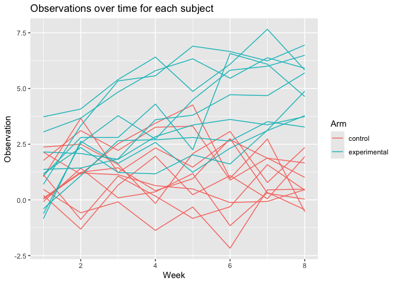

p8105_hw5_sr4354
================
sr4354
2026-11-17

## Homework 5

### Problem 2

``` r
study_df =
  tibble(
    files = list.files("data"),
    path = str_c("data/", files)
  )

study_df
```

    ## # A tibble: 20 × 2
    ##    files      path           
    ##    <chr>      <chr>          
    ##  1 con_01.csv data/con_01.csv
    ##  2 con_02.csv data/con_02.csv
    ##  3 con_03.csv data/con_03.csv
    ##  4 con_04.csv data/con_04.csv
    ##  5 con_05.csv data/con_05.csv
    ##  6 con_06.csv data/con_06.csv
    ##  7 con_07.csv data/con_07.csv
    ##  8 con_08.csv data/con_08.csv
    ##  9 con_09.csv data/con_09.csv
    ## 10 con_10.csv data/con_10.csv
    ## 11 exp_01.csv data/exp_01.csv
    ## 12 exp_02.csv data/exp_02.csv
    ## 13 exp_03.csv data/exp_03.csv
    ## 14 exp_04.csv data/exp_04.csv
    ## 15 exp_05.csv data/exp_05.csv
    ## 16 exp_06.csv data/exp_06.csv
    ## 17 exp_07.csv data/exp_07.csv
    ## 18 exp_08.csv data/exp_08.csv
    ## 19 exp_09.csv data/exp_09.csv
    ## 20 exp_10.csv data/exp_10.csv

``` r
study_df =
  study_df |>
  mutate(data = map(path, \(p) read_csv(p, show_col_types = FALSE)))

study_df
```

    ## # A tibble: 20 × 3
    ##    files      path            data              
    ##    <chr>      <chr>           <list>            
    ##  1 con_01.csv data/con_01.csv <spc_tbl_ [1 × 8]>
    ##  2 con_02.csv data/con_02.csv <spc_tbl_ [1 × 8]>
    ##  3 con_03.csv data/con_03.csv <spc_tbl_ [1 × 8]>
    ##  4 con_04.csv data/con_04.csv <spc_tbl_ [1 × 8]>
    ##  5 con_05.csv data/con_05.csv <spc_tbl_ [1 × 8]>
    ##  6 con_06.csv data/con_06.csv <spc_tbl_ [1 × 8]>
    ##  7 con_07.csv data/con_07.csv <spc_tbl_ [1 × 8]>
    ##  8 con_08.csv data/con_08.csv <spc_tbl_ [1 × 8]>
    ##  9 con_09.csv data/con_09.csv <spc_tbl_ [1 × 8]>
    ## 10 con_10.csv data/con_10.csv <spc_tbl_ [1 × 8]>
    ## 11 exp_01.csv data/exp_01.csv <spc_tbl_ [1 × 8]>
    ## 12 exp_02.csv data/exp_02.csv <spc_tbl_ [1 × 8]>
    ## 13 exp_03.csv data/exp_03.csv <spc_tbl_ [1 × 8]>
    ## 14 exp_04.csv data/exp_04.csv <spc_tbl_ [1 × 8]>
    ## 15 exp_05.csv data/exp_05.csv <spc_tbl_ [1 × 8]>
    ## 16 exp_06.csv data/exp_06.csv <spc_tbl_ [1 × 8]>
    ## 17 exp_07.csv data/exp_07.csv <spc_tbl_ [1 × 8]>
    ## 18 exp_08.csv data/exp_08.csv <spc_tbl_ [1 × 8]>
    ## 19 exp_09.csv data/exp_09.csv <spc_tbl_ [1 × 8]>
    ## 20 exp_10.csv data/exp_10.csv <spc_tbl_ [1 × 8]>

``` r
study_df =
  study_df |>
  unnest(data)

study_df
```

    ## # A tibble: 20 × 10
    ##    files      path       week_1 week_2 week_3 week_4 week_5 week_6 week_7 week_8
    ##    <chr>      <chr>       <dbl>  <dbl>  <dbl>  <dbl>  <dbl>  <dbl>  <dbl>  <dbl>
    ##  1 con_01.csv data/con_…   0.2   -1.31   0.66   1.96   0.23   1.09   0.05   1.94
    ##  2 con_02.csv data/con_…   1.13  -0.88   1.07   0.17  -0.83  -0.31   1.58   0.44
    ##  3 con_03.csv data/con_…   1.77   3.11   2.22   3.26   3.31   0.89   1.88   1.01
    ##  4 con_04.csv data/con_…   1.04   3.66   1.22   2.33   1.47   2.7    1.87   1.66
    ##  5 con_05.csv data/con_…   0.47  -0.58  -0.09  -1.37  -0.32  -2.17   0.45   0.48
    ##  6 con_06.csv data/con_…   2.37   2.5    1.59  -0.16   2.08   3.07   0.78   2.35
    ##  7 con_07.csv data/con_…   0.03   1.21   1.13   0.64   0.49  -0.12  -0.07   0.46
    ##  8 con_08.csv data/con_…  -0.08   1.42   0.09   0.36   1.18  -1.16   0.33  -0.44
    ##  9 con_09.csv data/con_…   0.08   1.24   1.44   0.41   0.95   2.75   0.3    0.03
    ## 10 con_10.csv data/con_…   2.14   1.15   2.52   3.44   4.26   0.97   2.73  -0.53
    ## 11 exp_01.csv data/exp_…   3.05   3.67   4.84   5.8    6.33   5.46   6.38   5.91
    ## 12 exp_02.csv data/exp_…  -0.84   2.63   1.64   2.58   1.24   2.32   3.11   3.78
    ## 13 exp_03.csv data/exp_…   2.15   2.08   1.82   2.84   3.36   3.61   3.37   3.74
    ## 14 exp_04.csv data/exp_…  -0.62   2.54   3.78   2.73   4.49   5.82   6      6.49
    ## 15 exp_05.csv data/exp_…   0.7    3.33   5.34   5.57   6.9    6.66   6.24   6.95
    ## 16 exp_06.csv data/exp_…   3.73   4.08   5.4    6.41   4.87   6.09   7.66   5.83
    ## 17 exp_07.csv data/exp_…   1.18   2.35   1.23   1.17   2.02   1.61   3.13   4.88
    ## 18 exp_08.csv data/exp_…   1.37   1.43   1.84   3.6    3.8    4.72   4.68   5.7 
    ## 19 exp_09.csv data/exp_…  -0.4    1.08   2.66   2.7    2.8    2.64   3.51   3.27
    ## 20 exp_10.csv data/exp_…   1.09   2.8    2.8    4.3    2.25   6.57   6.09   4.64

``` r
study_df =
  study_df |>
  mutate(
    files = str_remove(files, "\\.csv$"),
    arm = str_sub(files, 1, 3)
  )
```

``` r
study_df =
  study_df |>
  pivot_longer(
    week_1:week_8,
    names_to = "week",
    names_prefix = "week_",
    values_to = "observation"
  )
```

``` r
study_df =
  study_df |>
  mutate(
    week = as.numeric(week),
    arm = recode(arm, con = "control", exp = "experimental")
  ) |>
  select(arm, subject_id = files, week, observation)

study_df
```

    ## # A tibble: 160 × 4
    ##    arm     subject_id  week observation
    ##    <chr>   <chr>      <dbl>       <dbl>
    ##  1 control con_01         1        0.2 
    ##  2 control con_01         2       -1.31
    ##  3 control con_01         3        0.66
    ##  4 control con_01         4        1.96
    ##  5 control con_01         5        0.23
    ##  6 control con_01         6        1.09
    ##  7 control con_01         7        0.05
    ##  8 control con_01         8        1.94
    ##  9 control con_02         1        1.13
    ## 10 control con_02         2       -0.88
    ## # ℹ 150 more rows

``` r
study_df |>
  ggplot(aes(x = week, y = observation, group = subject_id, color = arm)) +
  geom_line() +
  labs(
    x = "Week",
    y = "Observation",
    color = "Arm",
    title = "Observations over time for each subject"
  )
```

<!-- --> At
week 1, both groups start at similar levels, with most observations
between about 0 and 2.5. Over the 8 weeks, the control group fluctuates
around roughly the same values with no clear trend, while the
experimental group trends upward, with several subjects reaching 5 to 7
by week 8. By the end of the study, experimental observations are
generally higher than control observations. There is considerable
variation between individuals in both arms, particularly in the
experimental arm, suggesting that responses differ between subjects.
