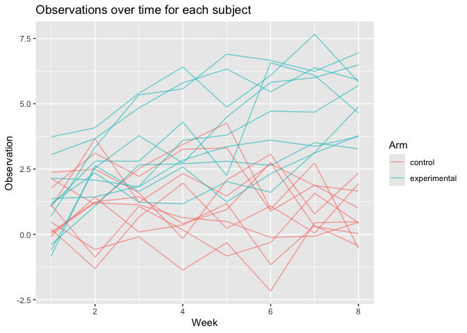

p8105_hw5_sr4354
================
sr4354
2026-11-17

## Homework 5

### Problem 2

``` r
study_df =
  tibble(
    files = list.files("data"),
    path = str_c("data/", files)
  ) |>
  mutate(data = map(path, \(p) read_csv(p, show_col_types = FALSE))) |>
  unnest(data) |>
  mutate(
    files = str_remove(files, "\\.csv$"),
    arm = str_sub(files, 1, 3)
  ) |>
  pivot_longer(
    week_1:week_8,
    names_to = "week",
    names_prefix = "week_",
    values_to = "observation"
  ) |>
  mutate(
    week = as.numeric(week),
    arm = recode(arm, con = "control", exp = "experimental")
  ) |>
  select(arm, subject_id = files, week, observation)

study_df
```

    ## # A tibble: 160 × 4
    ##    arm     subject_id  week observation
    ##    <chr>   <chr>      <dbl>       <dbl>
    ##  1 control con_01         1        0.2 
    ##  2 control con_01         2       -1.31
    ##  3 control con_01         3        0.66
    ##  4 control con_01         4        1.96
    ##  5 control con_01         5        0.23
    ##  6 control con_01         6        1.09
    ##  7 control con_01         7        0.05
    ##  8 control con_01         8        1.94
    ##  9 control con_02         1        1.13
    ## 10 control con_02         2       -0.88
    ## # ℹ 150 more rows

``` r
study_df |>
  ggplot(aes(x = week, y = observation, group = subject_id, color = arm)) +
  geom_line(alpha = 0.6) +
  labs(
    x = "Week",
    y = "Observation",
    color = "Arm",
    title = "Observations over time for each subject"
  )
```

<!-- -->

At week 1, both groups start at similar levels, with most observations
between about 0 and 2.5. Over the 8 weeks, the control group fluctuates
around roughly the same values with no clear trend, while the
experimental group trends upward, with several subjects reaching 5 to 7
by week 8. By the end of the study, experimental observations tend to be
higher than control observations. There is considerable variation
between individuals in both arms, particularly in the experimental arm,
suggesting that responses differ between subjects.

### Problem 3
