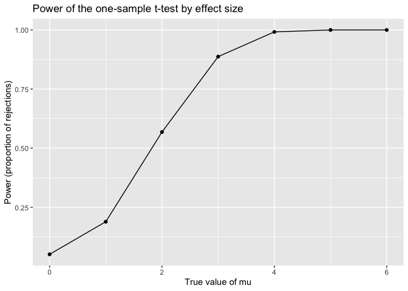
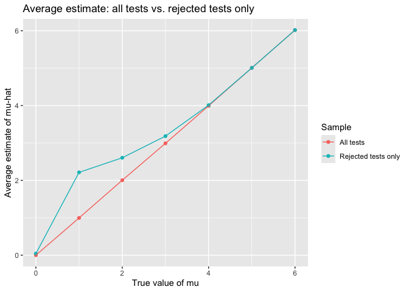

p8105_hw5_sr4354
================
sr4354
2026-11-17

## Homework 5

### Problem 2

``` r
study_df =
  tibble(
    files = list.files("data"),
    path = str_c("data/", files)
  ) |>
  mutate(data = map(path, \(p) read_csv(p, show_col_types = FALSE))) |>
  unnest(data) |>
  mutate(
    files = str_remove(files, "\\.csv$"),
    arm = str_sub(files, 1, 3)
  ) |>
  pivot_longer(
    week_1:week_8,
    names_to = "week",
    names_prefix = "week_",
    values_to = "observation"
  ) |>
  mutate(
    week = as.numeric(week),
    arm = recode(arm, con = "control", exp = "experimental")
  ) |>
  select(arm, subject_id = files, week, observation)

study_df
```

    ## # A tibble: 160 × 4
    ##    arm     subject_id  week observation
    ##    <chr>   <chr>      <dbl>       <dbl>
    ##  1 control con_01         1        0.2 
    ##  2 control con_01         2       -1.31
    ##  3 control con_01         3        0.66
    ##  4 control con_01         4        1.96
    ##  5 control con_01         5        0.23
    ##  6 control con_01         6        1.09
    ##  7 control con_01         7        0.05
    ##  8 control con_01         8        1.94
    ##  9 control con_02         1        1.13
    ## 10 control con_02         2       -0.88
    ## # ℹ 150 more rows

``` r
study_df |>
  ggplot(aes(x = week, y = observation, group = subject_id, color = arm)) +
  geom_line(alpha = 0.6) +
  labs(
    x = "Week",
    y = "Observation",
    color = "Arm",
    title = "Observations over time for each subject"
  )
```

<!-- -->

At week 1, both groups start at similar levels, with most observations
between about 0 and 2.5. Over the 8 weeks, the control group fluctuates
around roughly the same values with no clear trend, while the
experimental group trends upward, with several subjects reaching 5 to 7
by week 8. By the end of the study, experimental observations tend to be
higher than control observations. There is considerable variation
between individuals in both arms, particularly in the experimental arm,
suggesting that responses differ between subjects.

### Problem 3

``` r
sim_t_test = function(mu, n = 30, sigma = 5) {
  x = rnorm(n, mean = mu, sd = sigma)

  t.test(x, mu = 0) |>
    broom::tidy() |>
    select(estimate, p.value)
}
```

``` r
sim_t_test(mu = 0)
```

    ## # A tibble: 1 × 2
    ##   estimate p.value
    ##      <dbl>   <dbl>
    ## 1    0.412   0.629

``` r
sim_t_test(mu = 3)
```

    ## # A tibble: 1 × 2
    ##   estimate   p.value
    ##      <dbl>     <dbl>
    ## 1     3.66 0.0000223

``` r
sim_results_df =
  expand_grid(
    mu = 0:6,
    iter = 1:5000
  ) |>
  mutate(
    estimate_df = map(mu, sim_t_test)
  ) |>
  unnest(estimate_df)

sim_results_df
```

    ## # A tibble: 35,000 × 4
    ##       mu  iter estimate p.value
    ##    <int> <int>    <dbl>   <dbl>
    ##  1     0     1  0.551    0.534 
    ##  2     0     2  0.567    0.487 
    ##  3     0     3 -1.65     0.0599
    ##  4     0     4  1.19     0.229 
    ##  5     0     5  0.334    0.738 
    ##  6     0     6 -1.19     0.209 
    ##  7     0     7  0.122    0.887 
    ##  8     0     8  0.684    0.472 
    ##  9     0     9  1.09     0.218 
    ## 10     0    10  0.00198  0.998 
    ## # ℹ 34,990 more rows

``` r
sim_results_df |>
  group_by(mu) |>
  summarize(mean_estimate = mean(estimate))
```

    ## # A tibble: 7 × 2
    ##      mu mean_estimate
    ##   <int>         <dbl>
    ## 1     0     -0.000151
    ## 2     1      0.996   
    ## 3     2      2.00    
    ## 4     3      2.99    
    ## 5     4      3.99    
    ## 6     5      5.01    
    ## 7     6      6.02

``` r
power_df =
  sim_results_df |>
  group_by(mu) |>
  summarize(
    power = mean(p.value < 0.05),
    avg_estimate = mean(estimate)
  )

power_df
```

    ## # A tibble: 7 × 3
    ##      mu  power avg_estimate
    ##   <int>  <dbl>        <dbl>
    ## 1     0 0.0508    -0.000151
    ## 2     1 0.189      0.996   
    ## 3     2 0.568      2.00    
    ## 4     3 0.887      2.99    
    ## 5     4 0.992      3.99    
    ## 6     5 1          5.01    
    ## 7     6 1          6.02

``` r
power_df |>
  ggplot(aes(x = mu, y = power)) +
  geom_point() +
  geom_line() +
  labs(
    x = "True value of mu",
    y = "Power (proportion of rejections)",
    title = "Power of the one-sample t-test by effect size"
  )
```

<!-- -->

At μ = 0, the power is approximately 0.05 (5%). This is expected; when
the true effect size is zero, the null hypothesis is true, so the test
should only reject it at the significance level of 0.05. As μ increases,
power increases because larger effect sizes are easier to detect. The
increase is steepest between μ = 1 and μ = 3, and power eventually
levels off near 1 (100%) (the test is almost certain to detect the
effect).

``` r
rejected_df =
  sim_results_df |>
  filter(p.value < 0.05) |>
  group_by(mu) |>
  summarize(avg_estimate_rejected = mean(estimate))

rejected_df
```

    ## # A tibble: 7 × 2
    ##      mu avg_estimate_rejected
    ##   <int>                 <dbl>
    ## 1     0                0.0426
    ## 2     1                2.21  
    ## 3     2                2.60  
    ## 4     3                3.18  
    ## 5     4                4.01  
    ## 6     5                5.01  
    ## 7     6                6.02

``` r
compare_df =
  power_df |>
  select(mu, avg_estimate) |>
  left_join(rejected_df, by = "mu") |>
  pivot_longer(
    avg_estimate:avg_estimate_rejected,
    names_to = "sample",
    values_to = "mean_estimate"
  ) |>
  mutate(
    sample = recode(
      sample,
      avg_estimate = "All tests",
      avg_estimate_rejected = "Rejected tests only"
    )
  )
```

``` r
compare_df |>
  ggplot(aes(x = mu, y = mean_estimate, color = sample)) +
  geom_point() +
  geom_line() +
  labs(
    x = "True value of mu",
    y = "Average estimate of mu-hat",
    color = "Sample",
    title = "Average estimate: all tests vs. rejected tests only"
  )
```

<!-- -->

The average estimate across all tests is generally close to the true μ,
but the average estimate among rejected tests is higher than the true μ
when μ is small. This is because, when the effect is small, only samples
with unusually high estimates are likely to reach statistical
significance. As μ increases, power rises and more samples are rejected,
so the rejected group looks more like the full set of samples, and the
two averages converge by μ = 5. The sample average among rejected tests
is therefore not a good estimate of μ when power is low.
